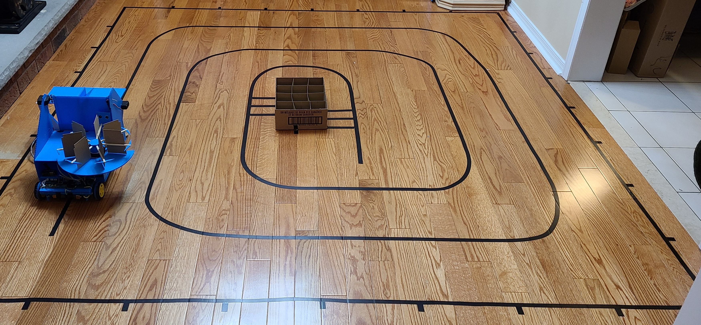

As part of a design course, I designed an autonomous robot to pick up and drop off soda cans in a team of 4. The robot operates by scooping the can into a bucket mounted to the front of the robot using a motorized arm, then flipping the bucket up and emptying the can into the next empty spot in the revolving storage area. The storage area hangs over the side of the robot so that cans can fall directly from the storage area to the drop-off bin once the robot reaches the centre of the track.

I designed the three circuit boards on the robot using EasyEDA. The main purpose of the design was to be modular and easy to test. Each of the sensors and motors on the robot are connected with removable connectors to headers on the board. As we each hand-soldered our own robots, it was important that we had a consistent and testable design so we could all help with troubleshooting. The motor drivers are on separate boards, a separate power supply, and connected to the control boards through optoisolators to reduce the impacts of electrical noise.

I also created an <a href="https://the-revolver-team-13-enph-253.github.io/">AR demo</a> of the can collection process in Blender to help visualize the robot's mode of operation.

