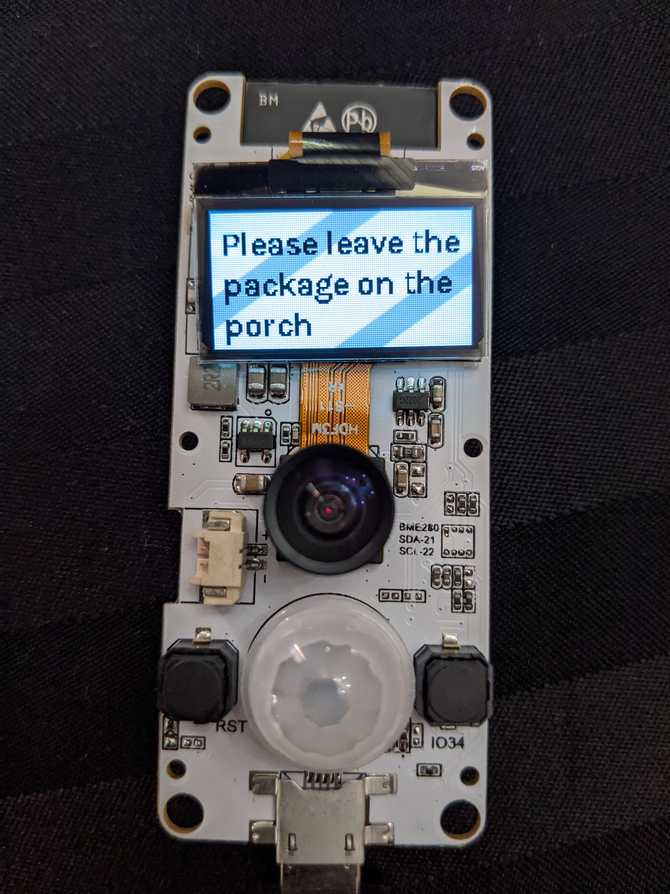

Since off the shelf video doorbells are very expensive and often require a subscription to use, I tasked myself with building one with an ESP32 camera module that costs less than 25 USD. I found an existing open-source video streaming project with the same hardware and modified it to turn on when motion is detected and automatically shutoff after 30 s of inactivity to save battery. I also added support for displaying messages on the integrated display by sending messages to the device over MQTT.

This project is available on <a href="https://github.com/ncarr/esp32-cam-mjpeg-multiclient">GitHub</a>

